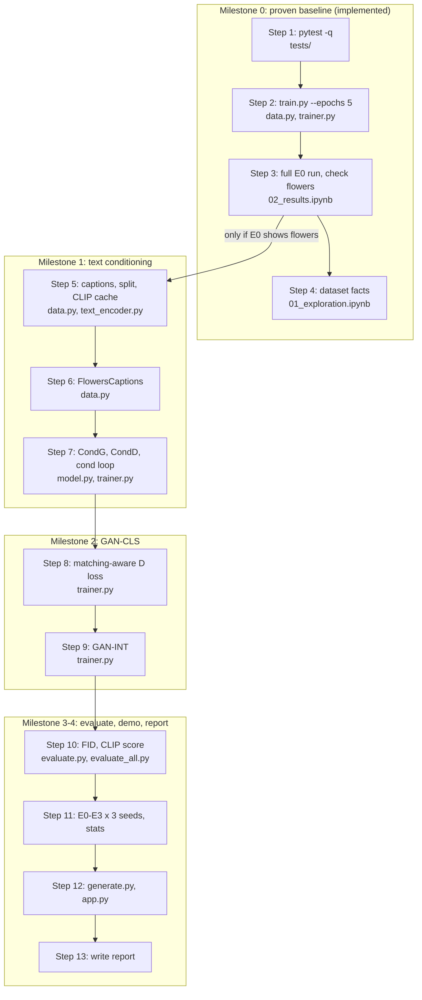
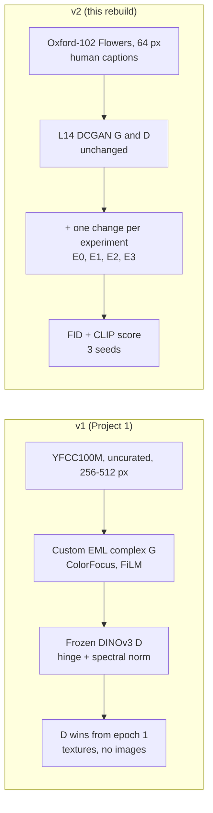
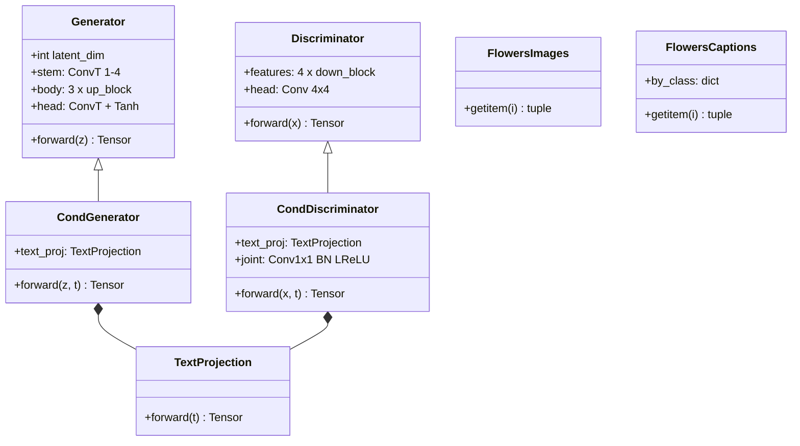
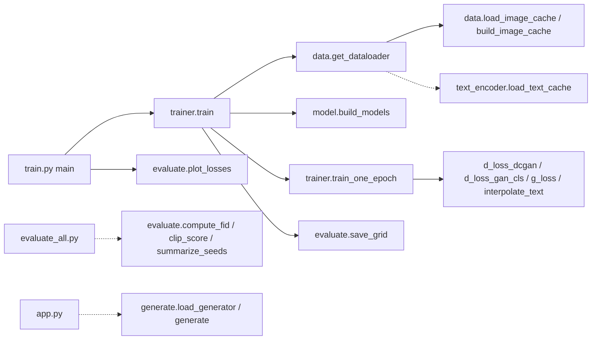
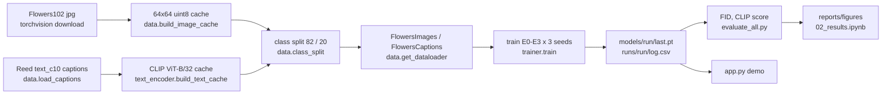
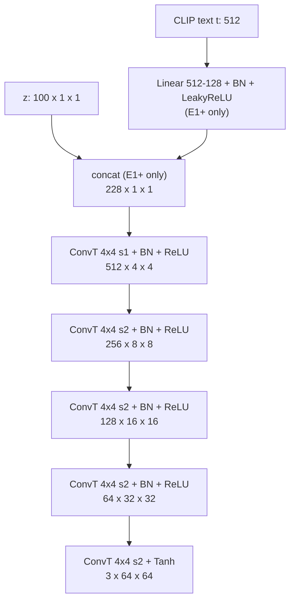
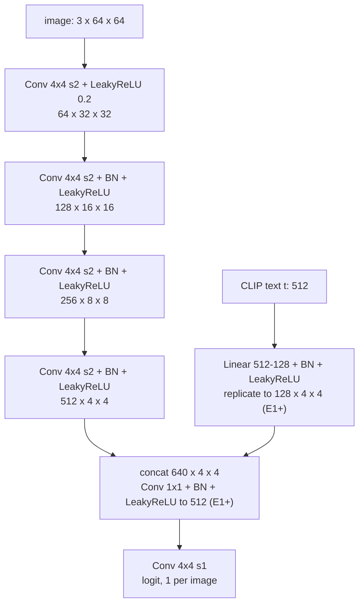
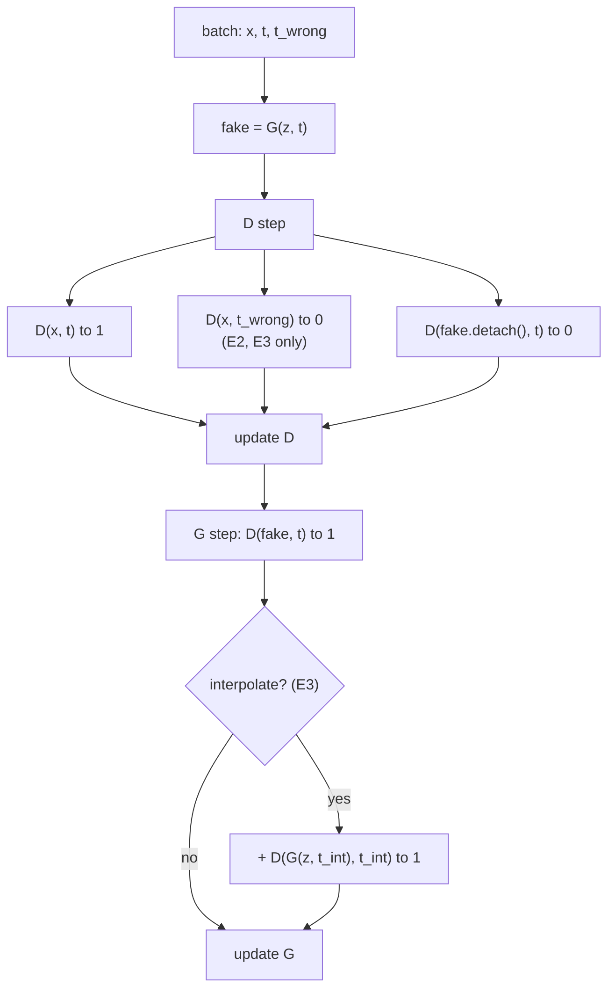
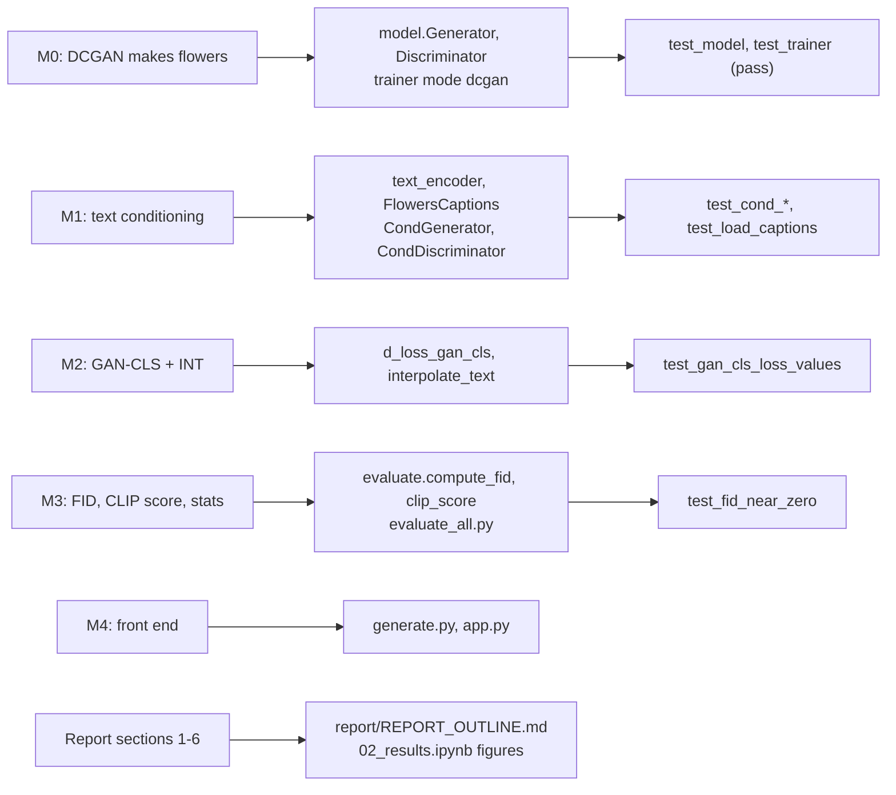

# Text-to-Image DCGAN (rebuild) — Diagrams
See [OUTLINE.md](OUTLINE.md)

## 1. Plan

The build order. Each milestone adds one piece on top of a verified one, and E0 must work before anything else.

## 2. Why v1 failed vs what v2 does

The structural difference: v1 changed everything at once on hard data; v2 starts from the class pipeline on easy data and changes one variable at a time.

## 3. Code structure

The conditional networks inherit the tested DCGAN blocks and add only the text projection. Datasets live in `src/data.py`.

Files → functions with "calls" arrows. Dashed arrows are milestone 1+ TODO paths.

## 4. ML pipeline

From raw files to report figures and the demo, with the function responsible for each stage.

## 5. Model architecture: generator

DCGAN generator (3.58M parameters for E0). E0 feeds z straight into the first ConvT (100 channels); E1+ concatenates the projected text first.

## 6. Model architecture: discriminator

DCGAN discriminator (2.77M parameters for E0). E0 goes from the 4×4×512 features straight to the head. E1+ joins the text at 4×4 (Reed et al. Fig. 2).

## 7. Training step (GAN-CLS, Reed et al. Algorithm 1)

One batch of `trainer.train_one_epoch`. E0 is the same loop without t, and E1 drops the wrong-caption term.

## 8. Requirements → code

Each requirement linked to the code that meets it and the test that checks it.
